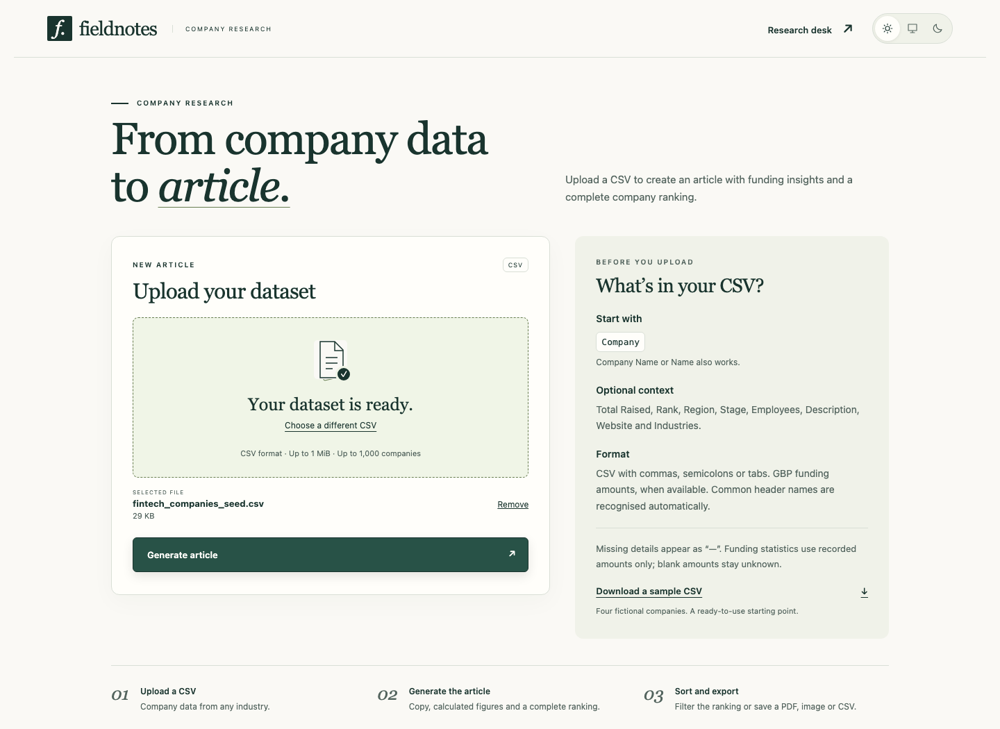
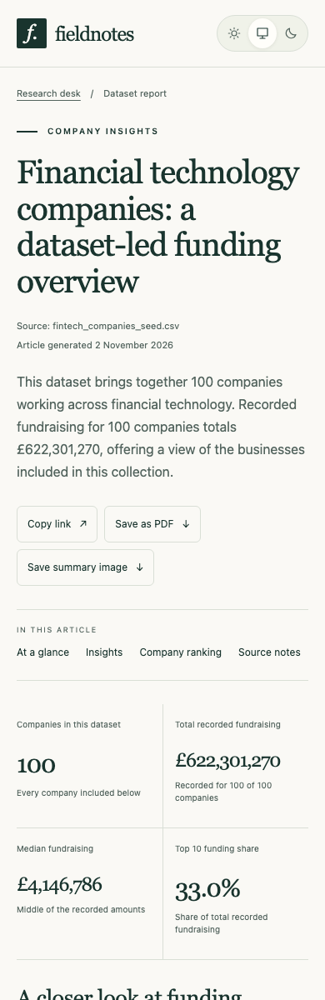

# Fieldnotes

### Drop a CSV. Get a report worth reading.

A reusable **Nuxt** toolbox for turning company datasets into SEO articles. Calculated facts, a complete ranking and practical exports, with generation kept on the server.

**[Explore the live report →](https://sherbini.uk/beauhurst-ai-seo-blog-generator/)** · **[Watch the walkthrough](https://sherbini.uk/beauhurst-ai-seo-blog-generator/#walkthrough)**

[](https://sherbini.uk/beauhurst-ai-seo-blog-generator/#walkthrough)

| 01 · Upload                                                        | 02 · Generate                                     | 03 · Explore                                         | 04 · Export                                               |
| ------------------------------------------------------------------ | ------------------------------------------------- | ---------------------------------------------------- | --------------------------------------------------------- |
| Drop a company CSV. Common headers and missing fields are handled. | Get an article, exact statistics and a saved URL. | Sort every column, search, filter and switch themes. | Save a PDF, a PNG brief or the selected companies as CSV. |

The Pages demo contains a prepared report; uploads and generation run in the private local toolbox. The recorded walkthrough uses a deterministic provider so it is reproducible without API calls.

## Run locally

**Node 24.22.2** · **npm** · a free-tier **Gemini API key**

```sh
nvm install && nvm use
npm ci
cp .env.example .env
# Set NUXT_GEMINI_API_KEY in .env
npm run dev
```

Open **http://127.0.0.1:3000**. Create a key in [Google AI Studio](https://aistudio.google.com/api-keys). Credentials stay server-side; use a project with available free-tier quota. For a production run: `npm run build && npm start`.

## Bring your own dataset

Start with a **Company**, **Company Name** or **Name** column. Funding and the other source fields are optional. Common header names, comma/semicolon/tab separators, missing trailing cells and incomplete ranks are handled automatically.

Missing information appears as **—**. Missing funding stays unknown, and statistics clearly state their coverage. Ambiguous amounts, unsupported currencies and broken CSV structure produce an actionable error. [Download the sample CSV](public/company-template.csv) or read the [import details](docs/usage.md).

## How it works

```text
CSV → normalise → calculate facts → generate validated prose → save → render
```

**Nuxt + TypeScript** provide the reusable SSR template. **Papa Parse + Zod** handle input and output contracts. **Gemini** supplies the prose; code supplies every authoritative figure. Articles persist as atomic JSON files. No paid service, database or animation/export library is required.

<details>
<summary>Light, dark and mobile views</summary>

| Light                                               | Dark                                              |
| --------------------------------------------------- | ------------------------------------------------- |
|  |  |



</details>

## Check it

```sh
npx playwright install chromium
npm run check
```

Formatting, lint, strict types, unit/integration tests, production build and desktop/mobile E2E. Tests never call a real provider. Refresh screenshots and video with `npm run screenshots` (requires Chromium and ffmpeg).

[Setup, imports and limits](docs/usage.md)
